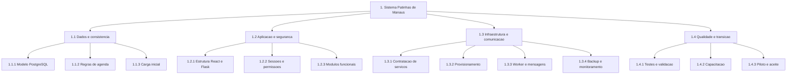
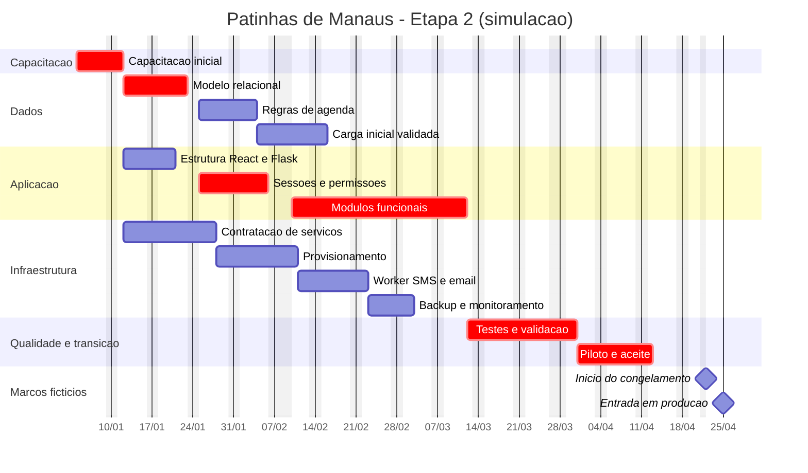

# Patinhas de Manaus: plano de projeto (Etapa 2)

**Instituição:** Centro Universitário de Ensino Superior do Amazonas (CIESA)  
**Disciplina:** Projetos de Sistemas  
**Modalidade:** trabalho individual; equipe técnica apenas hipotética  
**Sistema:** Patinhas de Manaus, pet shop privado fictício em Manaus (AM)  
**Documento:** `PLANO.md`, Etapa 2 - Do projeto ao plano de projeto  
**Base documental:** [`README.md` da Etapa 1](https://github.com/Hannah4Chan/patinhas-de-manaus/blob/main/README.md)  
**Situação:** versão consolidada para avaliação acadêmica e auditoria final. Nenhum software, contrato, equipe ou infraestrutura aqui descrito foi implementado ou contratado.  
**Data-base das estimativas:** novembro de 2026; valores e prazos futuros são hipóteses explícitas.

> **Objetivo.** Converter as decisões arquiteturais registradas na Etapa 1 em escopo, cronograma, custo, incerteza, riscos, aquisições e responsabilidades, segundo os domínios de gestão de projetos abordados no PMBOK. Este documento **não muda** as ADRs da primeira etapa nem é uma entrega de código.

## 1. Premissas, arquitetura de origem e rastreabilidade

### 1.1. Decisões preservadas

- **ADR-001:** PostgreSQL relacional, com transações e restrições para evitar agendamentos sobrepostos de profissional ou animal (RN03/RN09); migrações e preservação do histórico.
- **ADR-002:** autenticação por sessões mantidas no servidor e armazenadas no PostgreSQL, cookies protegidos, CSRF e autorização por perfil e titularidade (RNF03/RNF04).
- **ADR-003:** hospedagem gerenciada em nuvem para API Flask, worker de notificações e PostgreSQL, com backups e monitoramento (RNF05).
- **C4 N2/N3:** aplicação web React, servidor Flask/REST, banco PostgreSQL, processo Worker Python separado, e integração com provedores externos de SMS e e-mail.

**Delimitação:** continuam fora do escopo estoque, vendas, pagamentos on-line, prontuários veterinários, transporte de animais e aplicativo nativo. A carga inicial abrange cadastros, catálogo, jornadas e registros legados disponíveis, mesmo que sejam apenas planilhas ou papel. Não se afirma que exista um banco legado.

**Participantes:** a autora realiza individualmente o estudo acadêmico. Para simular a execução, o plano pressupõe quatro **papéis técnicos PJ com dedicação parcial**, um gestor de projeto (função de coordenação), um proprietário fictício e um administrador do estabelecimento que assumirá a operação diária. A equipe técnica deve estar previamente selecionada e apta a iniciar a mobilização na data-base. A contratação prévia de profissionais é uma **condição de início**; se não se concretizar, a data simulada deverá ser replanejada, sem mascarar a contratação como tarefa concluída.

### 1.2. Impacto das três ADRs sob seis ângulos

| Dimensão | ADR-001 | ADR-002 | ADR-003 |
| --- | --- | --- | --- |
| **Escopo** | Modelo relacional, migrações, prevenção de conflitos, carga inicial | Sessões, login, perfis, CSRF, testes de autorização | Provisionamento gerenciado, Worker, backup, telemetria, transição |
| **Cronograma** | Modelo antes de restrições e integração da agenda | Modelo e API antes do acesso protegido; sessão antes de módulos | Contratos antes do provisionamento; Worker e observabilidade antes do teste integrado |
| **Custo** | Engenharia SQL e banco gerenciado, migração, índices | Horas de segurança web, armazenamento de sessões, testes | Instalação e mensalidades em 36 meses; monitoramento, backup e terceiros |
| **Riscos** | Reserva duplicada, inconsistência de dados, desempenho | Vazamento de dados, sessão persistente, CSRF | Indisponibilidade, câmbio, SMS, dependência de provedor |
| **Aquisições** | Tecnologia PostgreSQL sem licença; contratar banco gerenciado | Implementação própria do controle de sessão; não terceirizar identidade inicialmente | Contratar hospedagem, monitor, domínio, SMS e e-mail; planejar saída |
| **Equipe** | Dev dados/backend com domínio de transações SQL | Full-stack com domínio de cookies, CSRF, matriz de acesso | Infra/integrações, QA e administrador treinados para operação |

**Decisão eliminatória:** a ADR-003 **elimina a compra, instalação, operação local e reposição de um servidor próprio** como parte do plano aprovado. Essas despesas permanecem apenas na alternativa rejeitada, para comparação financeira; não são somadas ao orçamento da nuvem.

## 2. Escopo: EAP em três níveis

**Nível 1:** projeto. **Nível 2:** quatro frentes de entrega. **Nível 3:** 13 pacotes verificáveis, incluindo migração/carga inicial, observabilidade e capacitação.

### 2.1. Dicionário de pacotes (modelo do Anexo A)

Cada pacote descreve uma entrega verificável e explicita sua decisão de origem, responsável e ligações de precedência. As durações PERT e riscos pessimistas aparecem reunidos na Seção 4, evitando divergências entre fichas e tabela de cálculo.

**Pacote 1.1.1 - Modelo relacional e migrações**  
**Entrega:** Esquema relacional, migrações versionadas e índices/restrições iniciais verificados.  
**Origem:** ADR-001; C4 N3; RN03/RN09.  
**Executor:** Dev dados/backend.  
**Depende de:** `1.4.2`. **Habilita:** `1.1.2`, `1.2.2`, `1.3.3`.  
**PERT:** 8,67 dias úteis (O=5; M=8; P=15); **cauda pessimista:** restrições e modelagem relacional exigirem retrabalho.

**Pacote 1.1.2 - Regras transacionais da agenda**  
**Entrega:** Transações e exclusão de intervalos conflitantes com teste de duas confirmações concorrentes.  
**Origem:** ADR-001; RN03/RN09.  
**Executor:** Dev dados/backend.  
**Depende de:** `1.1.1`. **Habilita:** `1.1.3`, `1.2.3`.  
**PERT:** 8,00 dias úteis (O=4; M=7; P=16); **cauda pessimista:** conflitos de agenda sob simultaneidade (R01).

**Pacote 1.1.3 - Carga inicial e validação de dados**  
**Entrega:** Catálogo, jornadas, tutores e profissionais iniciais conferidos; relatório de conferência de carga, sem inventar um legado.  
**Origem:** ADR-001; RN02/RN08/RN10; transição.  
**Executor:** Dev dados/backend.  
**Depende de:** `1.1.2`. **Habilita:** `1.4.1`.  
**PERT:** 5,50 dias úteis (O=3; M=5; P=10); **cauda pessimista:** planilhas inconsistentes e horários incompletos.

**Pacote 1.2.1 - Estrutura React e API Flask**  
**Entrega:** Cliente React e API Flask acessíveis em ambiente de desenvolvimento com contratos REST mínimos.  
**Origem:** C4 N2 (React/Flask).  
**Executor:** Dev full-stack.  
**Depende de:** `1.4.2`. **Habilita:** `1.2.2`.  
**PERT:** 6,67 dias úteis (O=4; M=6; P=12); **cauda pessimista:** ajustes no contrato entre React e Flask.

**Pacote 1.2.2 - Sessões, permissões e CSRF**  
**Entrega:** Login com sessão no PostgreSQL, regras por perfil e titularidade, cookies seguros e testes CSRF.  
**Origem:** ADR-002; RNF03/RNF04.  
**Executor:** Dev full-stack.  
**Depende de:** `1.2.1`, `1.1.1`. **Habilita:** `1.2.3`.  
**PERT:** 9,17 dias úteis (O=5; M=8; P=18); **cauda pessimista:** matriz de quatro perfis e CSRF (R03).

**Pacote 1.2.3 - Módulos funcionais**  
**Entrega:** Fluxos de cadastros, catálogo, agenda, atendimento, histórico, cancelamentos e relatórios, conforme 19 RFs.  
**Origem:** C4 N3; RF01–RF19; ADR-001/002.  
**Executor:** Dev full-stack.  
**Depende de:** `1.2.2`, `1.1.2`. **Habilita:** `1.4.1`.  
**PERT:** 22,00 dias úteis (O=12; M=20; P=40); **cauda pessimista:** quantidade de módulos e regras de negócio.

**Pacote 1.3.1 - Contratação de serviços e equipe**  
**Entrega:** Contas/planos contratados ou selecionados e credenciais seguras para nuvem, SMS, e-mail e monitoração; homologação SMS encaminhada.  
**Origem:** ADR-003; C4 N2 (externos).  
**Executor:** Infra/integrações; proprietário aprova.  
**Depende de:** `1.4.2`. **Habilita:** `1.3.2`.  
**PERT:** 11,67 dias úteis (O=5; M=10; P=25); **cauda pessimista:** homologação do remetente SMS atrasada.

**Pacote 1.3.2 - Provisionamento de ambientes, DNS/TLS**  
**Entrega:** Ambientes provisionados, banco privado, configuração DNS/HTTPS/TLS e mecanismo de publicação reproduzível.  
**Origem:** ADR-003; RNF03; C4 N2.  
**Executor:** Infra/integrações.  
**Depende de:** `1.3.1`. **Habilita:** `1.3.3`.  
**PERT:** 7,67 dias úteis (O=4; M=7; P=14); **cauda pessimista:** configuração de domínio, TLS e acesso privado ao banco.

**Pacote 1.3.3 - Worker, SMS e e-mail**  
**Entrega:** Worker Python independente da API, tabela de mensagens pendentes e adaptadores para SMS/e-mail, com retry e registro de falhas.  
**Origem:** C4 N2 (Worker); RF14/RF19; RNF02.  
**Executor:** Infra/integrações.  
**Depende de:** `1.3.2`, `1.1.1`. **Habilita:** `1.3.4`.  
**PERT:** 7,83 dias úteis (O=4; M=7; P=15); **cauda pessimista:** integração SMS/API e entrega assíncrona (R08).

**Pacote 1.3.4 - Backups, monitoramento e alertas**  
**Entrega:** Backups diários externos, teste de restauração, monitor da home e da API a cada 60 s e alertas.  
**Origem:** ADR-003; RNF05; RN07.  
**Executor:** Infra/integrações.  
**Depende de:** `1.3.3`. **Habilita:** `1.4.1`.  
**PERT:** 5,50 dias úteis (O=3; M=5; P=10); **cauda pessimista:** rotina de backup e restauração exigir ajuste.

**Pacote 1.4.1 - Testes funcionais e RNFs**  
**Entrega:** Relatório de testes funcionais, concorrência, autorização, desempenho, disponibilidade, acessibilidade e compatibilidade.  
**Origem:** ADR-001/002/003; RNF01–RNF08.  
**Executor:** Analista de qualidade (com apoio técnico).  
**Depende de:** `1.2.3`, `1.3.4`, `1.1.3`. **Habilita:** `1.4.3`.  
**PERT:** 11,33 dias úteis (O=6; M=10; P=22); **cauda pessimista:** testes de carga e autorização detectarem falhas.

**Pacote 1.4.2 - Capacitação por competência**  
**Entrega:** Registro de capacitação com roteiro por função, horas e avaliação prática de SQL concorrente, sessões/CSRF, implantação e teste de carga.  
**Origem:** ADR-001 (SQL transacional e concorrência para DB), ADR-002 (sessões, cookies e CSRF para FS), ADR-003 (nuvem, backups e restauração para IF) e RNF01/RNF02 (teste de carga para QA).  
**Executor:** Analista de qualidade + treinandos.  
**Depende de:** nenhum. **Habilita:** `1.1.1`, `1.2.1`, `1.3.1`.  
**PERT:** 5,50 dias úteis (O=3; M=5; P=10); **cauda pessimista:** ferramentas e rotinas desconhecidas pela equipe.

**Pacote 1.4.3 - Piloto, aceite e passagem à operação**  
**Entrega:** Piloto com dados conferidos, aceite formal do proprietário, runbook, acesso operacional e estratégia de reversão.  
**Origem:** ADR-003; RNF05; transição operacional.  
**Executor:** Qualidade e infraestrutura; proprietário aprova.  
**Depende de:** `1.4.1`. **Habilita:** encerramento e operação.  
**PERT:** 8,67 dias úteis (O=5; M=8; P=15); **cauda pessimista:** reprovação no aceite e ajustes de operação.

## 3. Rede de dependências e critérios de sequenciamento

A tabela de precedências do dicionário é a fonte do CPM e do Gantt. A justificativa principal é técnica ou de nivelamento de recursos, nunca uma tentativa de escolher artificialmente o caminho crítico.

| Dependência | Justificativa |
| --- | --- |
| 1.4.2 → 1.1.1, 1.2.1, 1.3.1 | A equipe recebe treinamento/mobilização inicial antes de iniciar entregas técnicas e aquisição operada pelo mesmo especialista; há uma única pessoa por papel. |
| 1.1.1 → 1.1.2, 1.2.2 | Regras transacionais e persistência de sessão precisam do esquema PostgreSQL. |
| 1.1.2 → 1.1.3, 1.2.3 | Carga e cadastro de horários não devem antecipar regras de integridade; mesmo dev de dados executa ambos, em série. |
| 1.2.1 → 1.2.2 | Autorização depende da estrutura de API e rotas existentes. |
| 1.1.1 + 1.2.1 → 1.2.2 | Sessões armazenadas no PostgreSQL exigem esquema e API. |
| 1.1.2 + 1.2.2 → 1.2.3 | Módulos de agenda precisam de integridade transacional e controle de permissões. |
| 1.3.1 → 1.3.2 | Provisionamento depende de contas, contratação e credenciais autorizadas. |
| 1.3.2 + 1.1.1 → 1.3.3 | Worker requer ambiente e a tabela de notificações; a segunda ligação é redundante em prazo, mas reforça rastreabilidade. |
| 1.3.3 → 1.3.4 | Especialista de infraestrutura é um só; monitoramento e teste de backup vêm após o Worker no nivelamento de recurso. |
| 1.1.3 + 1.2.3 + 1.3.4 → 1.4.1 | Homologação integrada requer dados, módulos e telemetria; testes de indisponibilidade precisam de instrumentação. |
| 1.4.1 → 1.4.3 | Aceite e transferência operacional só depois da evidência de testes e correções. |

### 3.1. Trabalho paralelo e nivelamento

Depois da capacitação, **dados**, **aplicação** e **infraestrutura** avançam em paralelo, cada qual com seu responsável técnico. O dev de dados executa `1.1.2` antes de `1.1.3`; o especialista em infraestrutura executa `1.3.3` antes de `1.3.4`. Isso evita a dupla alocação indevida que havia em rascunhos anteriores. No pacote `1.4.1` participam QA e colaboradores técnicos, com frações de jornada previstas no orçamento, não 100% de todos os quatro papéis.

**Capacitação:** ocupa os primeiros 5,5 dias PERT (6 dias inteiros no Gantt). Dentro desse intervalo de treinamento, o dev de dados recebe 2,2 dias-pessoa, o full-stack 2,2, o especialista de infra 3,3, e QA conduz/realiza atividades equivalentes a 5,5 dias-pessoa. Esses esforços **estão incluídos na mão de obra**. A preparação anterior dos contratos PJ é premissa para o início simulado, não tarefa invisível de duração zero.

### 3.2. Marcos imóveis e calendário

- **Início simulado:** segunda-feira, 04/01/2027, condicionado à equipe disponível.
- **Concluir pacotes:** previsão de segunda-feira, **12/04/2027**, no Gantt arredondado de 68 dias úteis, considerando fins de semana e as exclusões informadas.
- **Congelamento das alterações:** quinta-feira, **22/04/2027, às 08h**, até domingo, 25/04/2027, às 08h; são **72 horas corridas**. O congelamento não bloqueia o atendimento cotidiano do pet shop, somente alterações técnicas.
- **Entrada em produção:** domingo, **25/04/2027**, às 08h, janela sem expediente e aprovada **hipoteticamente** pelo proprietário; rollback se os critérios de aceite falharem.
- **Encontro 2 do professor:** checkpoint da EAP e do caminho crítico, sem data divulgada no enunciado. Não confundir com marcos fictícios do negócio.

**Calendário de trabalho da equipe de projeto:** segunda a sexta; sábados e domingos excluídos. Para a simulação, 08/02/2027 é folga assumida por hipótese; 09/02/2027 (Carnaval), 26/03/2027 (Paixão de Cristo) e 21/04/2027 (Tiradentes) não são dias úteis. A exclusão de 21/04 não muda o término das tarefas, que já acabam em 12/04; ela serve para contar corretamente os dias disponíveis antes do congelamento. **A manhã de 10/02 (Cinzas) não está descontada automaticamente no Mermaid:** eventual perda de meio dia será absorvida pela margem ou exigirá atualização da disponibilidade do recurso. Validar calendário local antes de qualquer execução real.

**Margem de calendário antes do congelamento:** entre a conclusão prevista em 12/04/2027 e o início do congelamento, em 22/04/2027 às 08h, há **6 dias úteis efetivos** (13, 14, 15, 16, 19 e 20 de abril; 21/04 é feriado). Essa margem equivale a cerca de **0,94 desvio-padrão** do caminho crítico estimado (6 ÷ 6,3640). Não é nova duração de um pacote nem garantia estatística; é a folga de calendário para tratar atrasos antes do marco fixo.

A data de 25/04 **não foi indicada pelo professor** e pode mudar se a equipe, um fornecedor ou o aceite exigirem. São marcos imóveis dentro da **simulação aprovada**, não compromissos institucionais.

### 3.3. Gantt em Mermaid

O Gantt utiliza durações PERT **arredondadas individualmente para cima**, produzindo 68 dias úteis na trilha crítica. A rede matemática (Seção 4) usa frações sem arredondamento. Assim, **a duração do Gantt não substitui a duração esperada PERT** e suas folgas.

O congelamento de 72 horas é descrito em texto com hora explícita. Não é representado como tarefa `3d` do Gantt, porque a exclusão de fins de semana alteraria o seu significado.

## 4. PERT, CPM e faixa de incerteza

Para cada um dos 13 pacotes, em **dias úteis**, calcula-se `t = (O + 4M + P)/6` e `σ = (P − O)/6`. Os valores são estimativas hipotéticas justificadas pelos riscos da ficha do pacote; **não são tempos medidos**. O, M e P são três cenários de duração de cada atividade, não limites garantidos.

| ID | Pacote | O | M | P | PERT (d) | σ (d) |
| --- | --- | --- | --- | --- | --- | --- |
| `1.1.1` | Modelo relacional e migrações | 5 | 8 | 15 | 8,67 | 1,67 |
| `1.1.2` | Regras transacionais da agenda | 4 | 7 | 16 | 8,00 | 2,00 |
| `1.1.3` | Carga inicial e validação de dados | 3 | 5 | 10 | 5,50 | 1,17 |
| `1.2.1` | Estrutura React e API Flask | 4 | 6 | 12 | 6,67 | 1,33 |
| `1.2.2` | Sessões, permissões e CSRF | 5 | 8 | 18 | 9,17 | 2,17 |
| `1.2.3` | Módulos funcionais | 12 | 20 | 40 | 22,00 | 4,67 |
| `1.3.1` | Contratação de serviços e equipe | 5 | 10 | 25 | 11,67 | 3,33 |
| `1.3.2` | Provisionamento de ambientes, DNS/TLS | 4 | 7 | 14 | 7,67 | 1,67 |
| `1.3.3` | Worker, SMS e e-mail | 4 | 7 | 15 | 7,83 | 1,83 |
| `1.3.4` | Backups, monitoramento e alertas | 3 | 5 | 10 | 5,50 | 1,17 |
| `1.4.1` | Testes funcionais e RNFs | 6 | 10 | 22 | 11,33 | 2,67 |
| `1.4.2` | Capacitação por competência | 3 | 5 | 10 | 5,50 | 1,17 |
| `1.4.3` | Piloto, aceite e passagem à operação | 5 | 8 | 15 | 8,67 | 1,67 |

### 4.1. CPM: inícios, términos e folgas calculados

O cálculo utiliza um grafo acíclico e passagens para frente (ES/EF) e para trás (LS/LF). O tempo zero representa 04/01/2027 antes das exclusões do calendário. Todos os números abaixo derivam do **mesmo conjunto de dependências** usado no Gantt.

| ID | ES | EF | LS | LF | Folga (dias úteis) |
| --- | --- | --- | --- | --- | --- |
| `1.1.1` | 5,50 | 14,17 | 5,50 | 14,17 | 0,00 |
| `1.1.2` | 14,17 | 22,17 | 15,33 | 23,33 | 1,17 |
| `1.1.3` | 22,17 | 27,67 | 39,83 | 45,33 | 17,67 |
| `1.2.1` | 5,50 | 12,17 | 7,50 | 14,17 | 2,00 |
| `1.2.2` | 14,17 | 23,33 | 14,17 | 23,33 | 0,00 |
| `1.2.3` | 23,33 | 45,33 | 23,33 | 45,33 | 0,00 |
| `1.3.1` | 5,50 | 17,17 | 12,67 | 24,33 | 7,17 |
| `1.3.2` | 17,17 | 24,83 | 24,33 | 32,00 | 7,17 |
| `1.3.3` | 24,83 | 32,67 | 32,00 | 39,83 | 7,17 |
| `1.3.4` | 32,67 | 38,17 | 39,83 | 45,33 | 7,17 |
| `1.4.1` | 45,33 | 56,67 | 45,33 | 56,67 | 0,00 |
| `1.4.2` | 0,00 | 5,50 | 0,00 | 5,50 | 0,00 |
| `1.4.3` | 56,67 | 65,33 | 56,67 | 65,33 | 0,00 |

**Caminho crítico:** `1.4.2 → 1.1.1 → 1.2.2 → 1.2.3 → 1.4.1 → 1.4.3`.  
**PERT total:** **65,3333 dias úteis**, ou aproximadamente **65,33 dias**.  
**Variância aproximada do caminho crítico:** **40,5000 dias²**.  
**Desvio-padrão aproximado:** **√40,5000 = 6,3640 dias**.  
**Gantt arredondado:** `68` dias úteis.  
**Caminhos quase críticos:** `1.1.2` tem folga de **1,17 dia**, enquanto a sequência de infraestrutura a partir de `1.3.1` possui **7,17 dias** de folga, **já considerando capacitação e nivelamento**.  
**Sensibilidade:** a maior incerteza individual está em `1.2.3`, com `σ=4,67` dias, exigindo revisão semanal de andamento.

Uma faixa **ilustrativa**, assumindo aproximação normal e independência das durações no caminho crítico, seria de **58,97 a 71,70 dias** (aproximadamente ±1 σ, cerca de 68%) ou **52,86 a 77,81 dias** (aproximadamente ±1,96 σ, cerca de 95%). Esses percentuais não são garantias: a rota crítica pode mudar quando tarefas não críticas se alongam ou recursos deixam de estar disponíveis.

**Nota metodológica:** a cauda pessimista de contratação SMS já considera a **demora na aprovação de remetente**; a contingência monetária para SMS cobre somente uma **recusa formal que obrigue a trocar de fornecedor**, não a mesma espera repetida duas vezes.

## 5. Comparação de custo de implantação e operação em três anos

### 5.1. Regras de comparação e premissas

Comparar o **mesmo escopo funcional** (19 RF, 8 RNF e 11 RN da Etapa 1) em (A) nuvem gerenciada, escolhida pela ADR-003, e (B) servidor local, alternativa rejeitada. Os valores são nominais, em reais e sem projeção de inflação; horizonte de 36 meses de operação **após a entrada em produção fictícia**. O câmbio **R$ 5,65 por USD** é uma **premissa fixa do modelo**, não proteção cambial nem taxa garantida. A finalidade é decisão de projeto, não orçamento contratual.

Hipóteses de escala: três profissionais atendem o pet shop; janela de operação **8h–18h, segunda a sábado (RN01)**, mas cada profissional cumpre uma jornada hipotética de **8 horas de trabalho por dia, com intervalo intrajornada de 1 hora fora dessas 8 horas**. Com serviço médio hipotético de 60 minutos e 15 minutos de manejo entre atendimentos, cabem **seis atendimentos completos por profissional/dia** (`6×60 + 5×15 = 435 min`, enquanto sete exigiriam 510 min). O pet shop abre cerca de **26 dias/mês**, mas **não se atribuem 26 jornadas a cada trabalhador**: considerando escala e descanso semanal, adotam-se **22 jornadas por profissional ao mês**, distribuídas pelos dias de abertura. Capacidade teórica da equipe = **3 × 6 × 22 = 396 atendimentos/mês**. A 45% de ocupação, estimam-se **178 agendamentos/mês** no ano 1. Esse é um teto simplificado de capacidade de equipe, sujeito à escala diária, férias, ausências, duração real dos serviços e limites de expediente; não significa três funcionários disponíveis em todos os 26 dias.

SMS: cerca de **222 mensagens/mês** no primeiro ano, considerando aproximadamente 178 confirmações, 14 cancelamentos (hipótese de 8% arredondada) e 30 códigos de verificação. Isso cabe no pacote de **até 1.000 SMS/mês por R$ 100/mês** anunciado pela Zenvia; a menor capacidade revisada **não altera o custo-base do SMS**, pois a franquia continua sendo o determinante. **A elegibilidade para envio transacional por API não está confirmada**; registrar risco de diferença de contratação. E-mail enviado por SES: consumo inferior a 300/mês inicialmente. Crescimento de tutores e mensagens assumido, sem reajuste estrutural da assinatura de SMS enquanto a franquia for suficiente.

Esforço da implantação: **121,02 dias-pessoa** hipotéticos, ou cerca de **44,5%** da capacidade nominal de quatro profissionais × 68 dias úteis do Gantt. A estimativa financeira é por **PJ/hora**, não CLT, e inclui os treinandos: R$ 100/h para dados, full-stack e QA; R$ 140/h para infra. Não se somam salário CLT e diária PJ. O custo por pacote provém de suas horas alocadas, não da dedicação integral de quatro pessoas por 68 dias. A jornada de referência para dias-pessoa é 8 horas.

**Custos por pacote**, distribuídos por horas efetivamente previstas (mão de obra PJ, sem infraestrutura recorrente):

| Pacote | Valor estimado de mão de obra |
|---|---:|
| 1.1.1 Modelo PostgreSQL | R$ 6.933,33 |
| 1.1.2 Regras transacionais | R$ 6.400,00 |
| 1.1.3 Carga inicial | R$ 2.640,00 |
| 1.2.1 Estrutura React/Flask | R$ 5.333,33 |
| 1.2.2 Sessões e permissões | R$ 7.333,33 |
| 1.2.3 Módulos funcionais | R$ 17.600,00 |
| 1.3.1 Contratação de serviços | R$ 3.266,67 |
| 1.3.2 Provisionamento | R$ 6.869,33 |
| 1.3.3 Worker e mensagens | R$ 7.018,67 |
| 1.3.4 Backup e monitoramento | R$ 3.696,00 |
| 1.4.1 Testes e validação | R$ 16.138,67 |
| 1.4.2 Capacitação, incluindo treinandos | R$ 11.616,00 |
| 1.4.3 Piloto e aceite | R$ 10.816,00 |
| **Total** | **R$ 105.661,33** |

O preço do pacote `1.4.2` inclui R$ 4.400,00 da participação de qualidade e R$ 7.216,00 dos três papéis treinados. O pacote `1.3.1` inclui apenas cerca de 25% de esforço produtivo, pois há espera por fornecedor. **Todos os valores têm como premissa tarifas PJ de referência e frações de dedicação por pacote**, não propostas comerciais.

**Custos unitários de referência**, pesquisados ou reusados das cotações de novembro de 2026, sujeitos a atualização: hospedagem [Render](https://render.com/pricing), disponibilidade [UptimeRobot](https://uptimerobot.com/pricing/), SMS [Zenvia, página geral de preços](https://zenvia.com/precos/), proteção de dados [Render Postgres backups](https://render.com/docs/postgresql-backups), agendamento [Render Cron Jobs](https://render.com/docs/cronjobs), máquina e nobreak em [Dell](https://www.dell.com/pt-br/shop/servidores-armazenamento-rede/servidor-em-torre-poweredge-t360/spd/poweredge-t360/pe_t360_18248_bcc_2) e [Kabum](https://www.kabum.com.br/produto/171518/nobreak-sms-atrium-at3000va-mono-220v-27852). Valores salariais, energia, conectividade e equipamento complementar estão detalhados como **premissas**, cotação inicial ou comparação referencial. Links para valores variáveis **não são garantia de manutenção do preço**. Na página do UptimeRobot consultada em 14/11/2026 em USD, o plano Solo com checagem a cada 60 segundos aparece a **US$ 12/mês na cobrança anual**; outras regiões podem exibir euros ou condições diferentes. Assim, a divergência regional de moeda é uma **pendência comercial**, não motivo para trocar silenciosamente o insumo do orçamento.

### 5.2. Alternativa A: nuvem gerenciada (escolhida)

| Componente | Custo mensal | Origem / condição |
| --- | --- | --- |
| Web service Standard, API Flask | US$ 25,00 | Preço de plano de referência |
| Worker Python Starter | US$ 7,00 | Preço de plano de referência |
| PostgreSQL gerenciado basic-1gb | US$ 19,00 | Preço de plano de referência |
| 10 GB adicionais de armazenamento | US$ 3,00 | 10 × US$ 0,30/GB |
| UptimeRobot Solo (60 s) | US$ 12,00 | Página oficial consultada em 14/11/2026: referência em USD, cobrança anual; preço regional pode variar |
| Cron para backup diário | US$ 1,00 | Mínimo de cobrança da Render |
| Armazenamento externo para dumps | US$ 1,00 | **Hipótese**, provedor ainda a contratar |
| **Subtotal mensal** | **US$ 68,00** | **R$ 384,20/mês** ao câmbio-base |

O armazenamento externo é **adicional ao PITR**, que no workspace Hobby cobre cerca de três dias. O plano prevê `pg_dump` diário criptografado em **Backblaze B2** (referência de preço por volume, não contratação), com **retenção de 30 cópias diárias e 12 cópias mensais de fechamento**, controle de acesso e teste de restauração trimestral. Para dimensionamento conservador de baixo volume, assume-se até **200 MB por arquivo compactado**, resultando em aproximadamente **8,4 GB** retidos (42 × 0,2 GB). A [tarifa divulgada para B2](https://www.backblaze.com/cloud-storage/pricing), a partir de US$ 6,95/TB/mês, dá ordem de grandeza inferior a US$ 1/mês apenas em armazenamento; o orçamento mantém **US$ 1/mês como hipótese prudencial**, sujeito a cobranças, volume, região e condições comerciais concretas. Os US$ 1/mês do cron job são cobrados separadamente. A retenção histórica de agendamentos (RN07) ocorre **na base da aplicação**; não deve ser confundida com a janela de restauração PITR ou com a retenção das cópias.

**Implantação A:** R$ 105.661,33 de horas PJ estimadas, **inclusive capacitação**, mais R$ 40,00 do registro de domínio referente ao primeiro ano = **R$ 105.701,33**.

| Custo operacional da nuvem | Ano 1 | Ano 2 | Ano 3 |
| --- | --- | --- | --- |
| Infra, observabilidade e backup | R$ 4.610,40 | R$ 4.610,40 | R$ 4.610,40 |
| Pacote SMS | R$ 1.200,00 | R$ 1.200,00 | R$ 1.200,00 |
| Amazon SES (envios estimados) | R$ 0,99 | R$ 1,19 | R$ 1,38 |
| Domínio (renovação, sem duplicar 1º ano) | R$ 0,00 | R$ 40,00 | R$ 40,00 |
| Manutenção: 8 h/mês a R$ 100/h | R$ 9.600,00 | R$ 9.600,00 | R$ 9.600,00 |
| **Total anual** | R$ 15.411,39 | R$ 15.451,59 | R$ 15.451,78 |

**Operação total em 36 meses:** **R$ 46.314,76**.  
**Reposições de hardware local:** R$ 0,00.  
**Custo-base de A em três anos:** **R$ 152.016,09**. A reserva financeira é apresentada separadamente na Seção 7.

### 5.3. Alternativa B: servidor próprio (rejeitada)

A comparação inclui o **mesmo código** e os mesmos 19 RFs, com esforço adicional de infraestrutura física. Entretanto, a configuração cotada continua tendo pontos únicos de falha e **não demonstra o RNF05**. Portanto, é uma alternativa financeira ilustrativa, **não tecnicamente equivalente** em disponibilidade; igualar a confiabilidade exigiria novas cotações de redundância.

| Implantação em servidor próprio | Valor | Classe |
| --- | --- | --- |
| Equipe PJ e cinco dias-pessoa extras de infraestrutura | R$ 111.261,33 | Estimativa de esforço |
| Servidor Dell PowerEdge T360 | R$ 22.999,00 | Cotação consultada em novembro/2026 |
| Nobreak senoidal | R$ 10.691,45 | Cotação consultada em novembro/2026 |
| Climatização e instalação | R$ 6.000,00 | **Hipótese** |
| Rack, cabeamento e elétrica | R$ 3.500,00 | **Hipótese** |
| Instalação de link dedicado | R$ 1.500,00 | **Hipótese** |
| Gerador e quadro de transferência | R$ 18.000,00 | **Hipótese** |
| Domínio, ano 1 | R$ 40,00 | Premissa de registro |
| **Implantação B** | R$ 173.991,78 | Soma das linhas |

| Operação servidor próprio | Ano 1 | Ano 2 | Ano 3 |
| --- | --- | --- | --- |
| Link dedicado | R$ 14.400,00 | R$ 14.400,00 | R$ 14.400,00 |
| Energia, climatização e hipótese tributária | R$ 6.882,09 | R$ 6.882,09 | R$ 6.882,09 |
| Manutenção 12 h/mês | R$ 14.400,00 | R$ 14.400,00 | R$ 14.400,00 |
| Monitoramento Solo | R$ 813,60 | R$ 813,60 | R$ 813,60 |
| Backup externo | R$ 1.017,00 | R$ 1.017,00 | R$ 1.017,00 |
| SMS | R$ 1.200,00 | R$ 1.200,00 | R$ 1.200,00 |
| SES e domínio renovado | R$ 0,99 | R$ 41,19 | R$ 41,38 |
| Suporte Dell adicional | R$ 0,00 | R$ 4.600,00 | R$ 4.600,00 |
| **Total anual** | R$ 38.713,68 | R$ 43.353,88 | R$ 43.354,07 |

**Operação em três anos B:** **R$ 125.421,63**; **reposições** previstas de bateria e disco = **R$ 4.300,00** (**hipótese**).  
**Total B:** **R$ 303.713,41**.

**Limitações que não podem ser omitidas:** máquina cotada com fonte não redundante e sem garantia de espelhamento de disco, enlace de operadora única, energia com premissa tributária e risco físico de acesso ao equipamento. A disponibilidade mensal de 99,5% (RNF05) só é comprovada por medições posteriores. O orçamento local não inclui segunda máquina ou link redundante; logo **não promete equivalência** com a nuvem.

### 5.4. Comparação de três anos e decisão

| Indicador | A - nuvem | B - local |
| --- | --- | --- |
| Implantação base | R$ 105.701,33 | R$ 173.991,78 |
| Operação em 36 meses | R$ 46.314,76 | R$ 125.421,63 |
| Reposições | R$ 0,00 | R$ 4.300,00 |
| **Total em 36 meses** | **R$ 152.016,09** | **R$ 303.713,41** |
| Atendimento técnico ao RNF05 | Apoiado por serviços gerenciados; requer medição | Não demonstrado com servidor e enlace únicos |

**Diferença absoluta:** **R$ 151.697,32**, com B custando aproximadamente **2,00 vezes** A. Comparar somente implantação ignora despesas recorrentes e reduz a visibilidade dos custos de 36 meses. Escolha: **A**, preservando ADR-003, por viabilidade operacional e menor custo esperado, sem presumir que hospedagem gerenciada garante automaticamente o SLA.

### 5.5. Teto financeiro e alçada

**Limite fictício adotado:** até **R$ 130.000,00 de implantação incluindo reservas**; até **R$ 20.000,00 por ano para operação incluindo reservas**. São limites definidos **para esta simulação de pet shop**, não orçamento divulgado pelo professor. O gestor acompanha a base e libera contingência identificada; somente o proprietário autoriza reserva gerencial e mudanças acima do teto.

## 6. Riscos: registro, resposta e gatilho

A arquitetura cria ou mitiga riscos; cada risco ativo possui **origem, resposta, gatilho mensurável, responsável e classificação de reserva**. Probabilidades e impactos são hipóteses de gestão, **não frequências medidas**.

| ID | Risco | Origem | Prob./impacto | Resposta / responsável | Gatilho | Reserva |
| --- | --- | --- | --- | --- | --- | --- |
| R01 | Agendamento duplo chega à produção | Arquitetural / ADR-001 | 10% / R$ 6.400 | Mitigar: exclusão no banco + teste de simultaneidade; dev dados | Sobreposição detectada em teste de carga ou aceite | Implantação; VME R$ 640 |
| R02 | Provedor rejeita formalmente remetente SMS | Projeto / C4 N2 | 10% / R$ 3.000 | Mitigar: cotar alternativa e trocar adaptador; infra | Recusa formal; pendência >10 dias gera escalonamento, mas não nova reserva de atraso | Implantação; VME R$ 300 |
| R03 | Falha de autorização/CSRF | Arquitetural / ADR-002 | 15% / R$ 7.333 | Mitigar: testes por perfil e titularidade; full-stack | Acesso cruzado permitido em teste | Implantação; VME R$ 1.099,95 |
| R04 | Banco insuficiente para p95 | Arquitetural / ADR-001 | 30% / R$ 2.440,80/ano | Mitigar: otimizar índices; migrar instância se necessário; infra | RNF01 p95 >2 s ou RNF02 p95 >3 s em carga contratada | Operação; VME R$ 732,24/ano |
| R05 | Disponibilidade abaixo de 99,5% | Arquitetural / ADR-003 | 20% / R$ 2.000/ano | Mitigar: monitor por minuto, alerta, plano de recuperação; operação | Resultado mensal <99,5% (216 min parados em mês de 30 dias) | Operação; VME R$ 400/ano |
| R06 | Recuperação PITR exige janela maior | Arquitetural / ADR-003 | 25% / R$ 1.695/ano | Mitigar: dumps externos e restore; ampliar workspace só se necessário; infra | Teste/objetivo de RPO/RTO exigir restauração granular >3 dias | Operação; VME R$ 423,75/ano |
| R07 | Câmbio maior eleva mensalidade USD | Projeto | 40% / R$ 922,08/ano | Mitigar: revisar câmbio, controlar plano, manter SMS em reais; gestor | USD > R$ 6,50 por 30 dias; revisão trimestral | Operação; VME R$ 368,83/ano |
| R08 | Worker vira envio síncrono nas rotas | Equipe/arquitetural / C4 N2 | 15% / R$ 4.000 | Evitar: critério de aceite exige processo independente; infra e QA | Inspeção de código comprova chamada externa durante HTTP | Implantação; VME R$ 600 |
| R09 | Conhecimento em único técnico fica indisponível | Equipe | 10% / R$ 5.000 | Mitigar: runbook e pareamento pontual; gestor | Ausência >5 dias úteis sem substituto | Implantação; VME R$ 500 |
| R10 | Plano Zenvia não cobre integração API | Projeto / aquisição | 30% / R$ 1.200/ano | Mitigar: verificar contrato/API antes da assinatura; infra | Proposta comercial restringe SMS API ou exige complemento | Operação; VME R$ 360/ano |
| R11 | Dupla reserva que ADR-001 procura evitar | Mitigado | — | Restrição no banco e teste em R01; não constitui nova despesa | — | Sem reserva adicional |

**Premissa do impacto de R05:** R$ 2.000/ano é uma hipótese de resposta extraordinária, composta por **10 horas adicionais de suporte técnico × R$ 100/h = R$ 1.000** e **até R$ 1.000 para ação corretiva ou ajuste temporário de infraestrutura**. Não é preço pesquisado nem custo recorrente garantido; é exposição financeira no cenário de falha, além das 8 h/mês de manutenção ordinária já orçadas.

Riscos R01, R03, R08 e R09 contabilizam **apenas retrabalho residual** não pago nos pacotes. A demora normal na aprovação do SMS já foi considerada na cauda `P=25` do pacote `1.3.1`; R02 cobre **recusa e re-integração**. Não somar a duração pessimista inteira do PERT à reserva de prazo.

## 7. Reservas de contingência e gerencial

**Base** é o custo esperado; **contingência** integra o orçamento do projeto e cobre variações identificáveis; **reserva gerencial** permanece fora da linha de base, requer liberação do proprietário e cobre imprevistos não listados.

### 7.1. Implantação: reserva única

O desvio aproximado do caminho crítico é `σ=6,3640 dias`; assume-se, como aproximação orçamentária, um prolongamento equivalente a **1 σ**, com média de **1,5 profissional ativo** e **R$ 873,09 por dia-pessoa** (taxa calculada sem arredondar antes da multiplicação). Isso produz **R$ 8.334,46**. A quantidade 1,5 é hipótese de esforço incremental, não regra estatística.

Exposição monetária esperada dos riscos discretos: R01 (R$ 640,00) + R02 (R$ 300,00) + R03 (R$ 1.099,95) + R08 (R$ 600,00) + R09 (R$ 500,00) = **R$ 3.139,95**.

**Contingência de implantação: R$ 11.474,41.** **Gerencial: 8% da base, R$ 8.456,11.** A reserva de tempo e a de retrabalho cobrem hipóteses distintas; evitar novas somas se o mesmo evento consumir ambas.

### 7.2. Operação: reserva anual

R04 (R$ 732,24/ano) + R05 (R$ 400,00/ano) + R06 (R$ 423,75/ano) + R07 (R$ 368,83/ano) + R10 (R$ 360,00/ano) = **R$ 2.284,82/ano**. A gerencial usa **8% da operação-base anual média**, ou **R$ 1.235,06/ano**, arredondados.

| Camada | Implantação (única) | Operação (média/ano) |
| --- | --- | --- |
| Base | R$ 105.701,33 | R$ 15.438,25 |
| Contingência | R$ 11.474,41 | R$ 2.284,82 |
| Orçamento sob gestão | R$ 117.175,74 | R$ 17.723,07 |
| Gerencial (só com proprietário) | R$ 8.456,11 | R$ 1.235,06 |
| **Autorização total estimada** | **R$ 125.631,85** | **R$ 18.958,13** |
| Teto fictício | R$ 130.000,00 | R$ 20.000,00 |

A operação anual tem pequenas diferenças por renovação de domínio e projeção de e-mails. O **Ano 3**, maior dos três, soma **R$ 15.451,78 de base + R$ 2.284,82 de contingência + R$ 1.235,06 de gerencial = R$ 18.971,66**, correspondentes a aproximadamente **94,9% do teto anual** de R$ 20.000,00. Não somar a reserva gerencial de três anos como despesa inicial: são autorizações de natureza diferente.

## 8. Aquisições: construir, contratar e possibilidade de saída

**Regra:** tecnologia de código aberto não elimina custo de competência; contrato de serviços não equivale a construir o produto. O plano de nuvem pressupõe contratação privada, sem licitação pública.

| Item | Construir/contratar | Origem | Custo/prazo-base | Prazo de contratação | Saída/lock-in |
| --- | --- | --- | --- | --- | --- |
| React/Flask, modelo e regras | Construir | ADR-001/002, C4 N2/N3 | Horas PJ dos pacotes 1.1 e 1.2 | Equipe pré-selecionada no início | Código e documentação pertencem ao projeto; reuso por outra equipe |
| Hospedagem API + Worker | Contratar | ADR-003, C4 N2 | US$ 32/mês | 1–3 dias após cadastro | Migrar variáveis de ambiente e deploy em 3–5 dias-pessoa (hipótese) |
| PostgreSQL gerenciado + storage | Contratar o serviço; construir o esquema | ADR-001/003 | US$ 22/mês | 1 dia, sujeito a aprovação | pg_dump/pg_restore; reconfiguração de TLS e conexões |
| SMS transacional | Contratar | RF01/RF14/RF19, C4 N2 | R$ 100/mês, API pendente | 5–15 dias úteis, **hipótese** | Reaprovar remetente + adaptar cliente (risco R02; impacto até R$ 3 mil) |
| E-mail transacional | Contratar | RF14, C4 N2 | Referência US$ 0,10/1.000 | 1–3 dias | Trocar SMTP/API, validar domínio e DKIM/SPF |
| UptimeRobot Solo | Contratar | ADR-003, RNF05 | US$ 12/mês | 1 dia | Recriar verificações e alertas em outro serviço |
| Cron + backup externo | Contratar infraestrutura; construir rotina | ADR-003, RN07 | US$ 1 cron + US$ 1 depósito (hipótese) | 1–3 dias | Exportação em formato PostgreSQL portável e restauração ensaiada |
| Domínio e certificado | Registrar domínio, TLS incluso no PaaS | ADR-002, RNF03 | R$ 40/ano de domínio | 1–2 dias | Domínio do titular: alterar DNS; novo TLS |
| Manutenção futura PJ | Contratar por horas | ADR-001/002/003 | 8 h/mês × R$ 100 | Contrato de suporte ao término | Runbook, métricas e credenciais sob controle do pet shop |

**O que a ADR-003 elimina:** compra do servidor, nobreak, gerador, link dedicado, montagem e administração física como execução escolhida. Autenticação terceirizada também não foi contratada, porque a ADR-002 já decidiu sessões próprias no servidor.

**Lei 14.133/2021.** Seu art. 1º se dirige às contratações da administração pública ali delimitada. Um pet shop **privado** não fica automaticamente obrigado a realizar licitação, mesmo que algum dia preste serviços à prefeitura. Por isso, **não existe mínimo legal universal de 90 dias para as compras do Patinhas**. No **cenário didático alternativo** de uma prefeitura adquirir diretamente uma solução de TI, o processo administrativo poderia consumir **90 dias como hipótese de planejamento**, dependendo do procedimento concreto. A duração não é um prazo mínimo fixo da Lei 14.133. Esse cenário **não entra no cronograma-base privado**.

**Sensibilidade didática, sem confundir prazo legal com hipótese:** se os **90 dias fossem adotados como dias úteis**, apenas para tornar as unidades comparáveis ao CPM, a duração de `1.3.1` passaria de 11,67 para 90 dias úteis. A frente de contratação viraria o gargalo e a rota crítica seria `1.4.2 → 1.3.1 → 1.3.2 → 1.3.3 → 1.3.4 → 1.4.1 → 1.4.3`, totalizando aproximadamente **136,50 dias úteis** (contra 65,33 no cenário privado). Trata-se de exercício contrafactual; **90 dias úteis não são um mínimo imposto pela lei**, nem a previsão da contratação real do pet shop.

Fonte normativa: [Lei 14.133/2021 (Planalto)](https://www.planalto.gov.br/ccivil_03/_ato2019-2022/2021/lei/l14133.htm).

## 9. Recursos humanos, RACI e operação após o aceite

**Papéis na simulação:** DB = desenvolvedor dados/backend; FS = full-stack; IF = infraestrutura/integrações; QA = qualidade/testes; GP = gestor do projeto; PR = proprietário; OP = administrador responsável pela operação diária. Na matriz: **R** executa, **A** aprova/responde pelo aceite, **C** é consultado e **I** informado. Cada pacote tem **um único A**, podendo ter vários R.

| ID | R | A (um só) | C | I |
| --- | --- | --- | --- | --- |
| `1.1.1` | DB | GP | FS | OP |
| `1.1.2` | DB | GP | QA | OP |
| `1.1.3` | DB | PR | QA, OP | GP |
| `1.2.1` | FS | GP | DB, IF | OP |
| `1.2.2` | FS | GP | DB, QA | PR |
| `1.2.3` | FS | GP | DB, PR | OP |
| `1.3.1` | IF | PR | GP, OP | QA |
| `1.3.2` | IF | GP | FS, OP | PR |
| `1.3.3` | IF | GP | DB, FS, QA | OP |
| `1.3.4` | IF | GP | QA, OP | PR |
| `1.4.1` | QA, DB, FS, IF | GP | OP | PR |
| `1.4.2` | QA, DB, FS, IF | GP | OP | PR |
| `1.4.3` | QA, IF, OP | PR | GP, FS, DB | — |

**Premissa de custo dos papéis de gestão:** as horas do gestor (na simulação, função acadêmica assumida pela autora) e do proprietário (validações pontuais dentro de suas atividades habituais) **não entram como desembolso incremental de contratação PJ**, por isso o orçamento da Seção 5 precifica apenas os quatro papéis técnicos. Isso não torna seu tempo economicamente gratuito: numa implantação real, seria necessário levantar e adicionar o custo de oportunidade e eventuais horas de coordenação remuneradas, revendo o teto se necessário.

O **gestor do projeto** conduz o planejamento fictício e controla a contingência, mas não assume a aprovação de contratos do proprietário. O **proprietário** assina aquisições, aprova os dados iniciais e formaliza o aceite. O **administrador do pet shop (OP)** recebe os procedimentos operacionais, monitora alertas, registra chamados e aciona o suporte contratado; não precisa dominar a administração profunda do PostgreSQL. A operação da infraestrutura subjacente segue a responsabilidade contratual do provedor; a manutenção evolutiva continua no plano de 8 h/mês.

A capacitação está na linha de base, é executada por QA e participada pelos demais técnicos: DB 2,2 dias-pessoa (SQL e transações), FS 2,2 (sessões e CSRF), IF 3,3 (provisionamento, backup e restauração) e QA 5,5 (teste de carga, observabilidade e documentação). A autora do estudo é uma pessoa só; a atribuição desses papéis é um **cenário de implantação**, não relato de uma equipe real que atuou na disciplina.

### 9.1. Lei de Brooks na execução proposta

O pacote `1.2.3` ocupa **22 dias esperados** e concentra a maior variância de prazo. Acrescentar uma pessoa já com ele atrasado demanda treinamento sobre modelo relacional, sessões e onze regras de negócio, consumindo tempo do próprio desenvolvedor crítico. A resposta prevista é reordenar ou negociar funcionalidades **de prioridade média** da Etapa 1, sem sacrificar as regras de agendamento, e usar a contingência de prazo; não pressupor aceleração linear por contratação tardia.

### 9.2. Lei de Conway no desenho da equipe

O C4 separa o processo de envio **Worker** da API, porém o mesmo especialista de infra integra e publica as duas partes. Isso cria incentivo para embutir o envio no pedido HTTP e violar o desenho assíncrono da Etapa 1. A contramedida é um **contrato de integração verificável** e teste de aceite: as rotas gravam evento pendente e respondem sem aguardar SMS/e-mail; o Worker separado envia mais tarde. A fronteira arquitetural fica protegida pelo processo de revisão, mesmo sem uma equipe exclusiva para cada contêiner.

## 10. Critérios de aceite e rastreabilidade final

| Verificação | Fonte | Aceite futuro |
| --- | --- | --- |
| Dados e concorrência | RF05/RF06, RN03/RN09, ADR-001 | Nenhuma dupla reserva de animal/profissional no teste de concorrência; preservar preço/duração do momento da reserva |
| Acesso e proteção | RF02/RF08/RF19, RNF03/RNF04, ADR-002 | HTTPS com TLS; autorização por perfil e proprietário; sessões/CSRF; nenhum acesso cruzado nos testes |
| Tempo de resposta | RNF01/RNF02, ADR-001 | p95 ≤2 s para consulta com 50 usuários e p95 ≤3 s para confirmação com 20 solicitações simultâneas, ambos por 10 minutos |
| Disponibilidade | RNF05, ADR-003 | Monitorar página inicial e API a cada minuto; meta ≥99,5% ao mês, com alertas e runbook |
| Envio assíncrono | RF14, RF19, RNF02, C4 N2 | Worker independente, fila transacional no banco, retry e falhas sem desfazer agendamento |
| Restauração | RN07, ADR-003 | Backup externo automático e teste de restore documentado, sem confundir retenção histórica com PITR |
| Operação e transição | ADR-003, 1.4.3 | Proprietário assina aceite, OP recebe runbook e contatos de suporte, com plano de retorno anterior ao corte |

**Evidências previstas, não realizadas:** relatórios de testes, logs de monitoramento, restauração testada, checklist de capacitação, aceite assinado e relatório da janela de implantação. No estágio acadêmico atual são critérios de planejamento, não comprovações de software em execução.

## 11. Fontes, limitações e aprovação da versão

1. [README.md da Etapa 1: requisitos, C4, ADRs e rastreabilidade](https://github.com/Hannah4Chan/patinhas-de-manaus/blob/main/README.md).
2. Enunciado **Etapa 2 - Do projeto ao plano de projeto**, disciplina Projetos de Sistemas, CIESA, cinco páginas (documento fornecido pelo professor).
3. PMI, **Guia PMBOK, 7ª edição**, conceitos de planejamento, entrega e incerteza, conforme o enunciado.
4. [Lei 14.133/2021, texto oficial, art. 1º](https://www.planalto.gov.br/ccivil_03/_ato2019-2022/2021/lei/l14133.htm).
5. [Render, preços de infraestrutura](https://render.com/pricing); [Render, política de backups e PITR](https://render.com/docs/postgresql-backups); [Render, cobrança de cron](https://render.com/docs/cronjobs).
6. [UptimeRobot, preço e intervalo de 60 segundos](https://uptimerobot.com/pricing/); [Zenvia, preços e franquia mensal de SMS](https://zenvia.com/precos/); [Zenvia, tabela de preço unitário por pacote](https://www.zenvia.com/materiais/docs/custos-por-pais.pdf).
7. Cotações referenciais de servidor, nobreak e mão de obra de novembro/2026, registradas no estudo de custos; todos os componentes sem cotação direta foram marcados como **hipótese**.

**Pendências honestas antes de uma contratação real:** confirmar tarifa e acesso SMS **por API transacional**, moeda/tributos dos serviços em dólar, preço e política do armazenamento externo, obrigações de backup/RTO-RPO, cronograma de recursos humanos caso os PJs não estejam mobilizados, feriados locais e requisitos reais de infraestrutura física. Cotações de equipamentos e serviços podem mudar.

**Checklist de rubrica:** EAP rastreável com três níveis e transição; dependências justificadas e caminho crítico calculado; Gantt Mermaid; custo de implantação e 36 meses para duas alternativas; 13 PERTs com incerteza; riscos com gatilho/reservas distintas; construir × contratar e legislação contextualizada; papéis e operador nomeados; Brooks e Conway aplicados ao caso.

**Controle de versão:** este arquivo foi produzido para revisão acadêmica. O `README.md` da Etapa 1 **não foi modificado**. A publicação no GitHub deve acontecer após auditoria final, preservando histórico do repositório.
