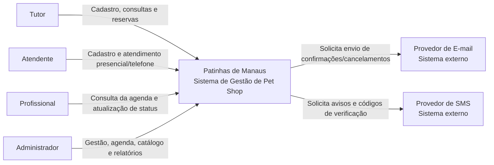
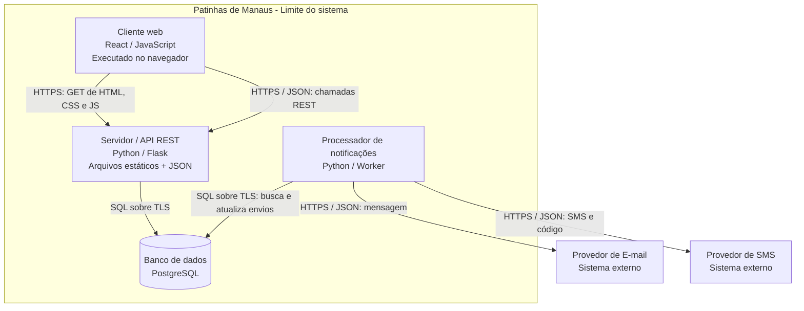
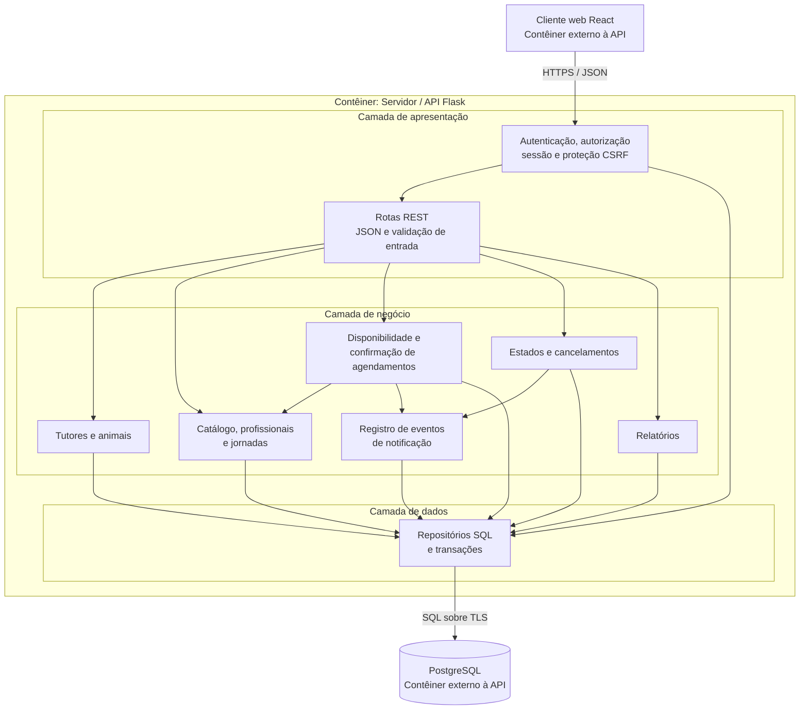
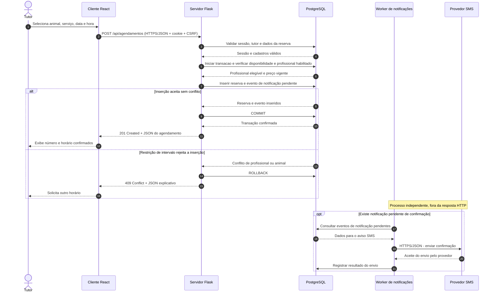

# Patinhas de Manaus: Requisitos e Arquitetura de um Sistema

**Instituição:** Centro Universitário de Ensino Superior do Amazonas (CIESA)  
**Disciplina:** Projetos de Sistemas  
**Modalidade:** Trabalho individual, com tema livre (conforme orientação verbal do professor)  
**Sistema:** Patinhas de Manaus, negócio fictício localizado em Manaus (AM)  
**Data da documentação:** 30/10/2026  
**Tipo de trabalho:** projeto conceitual, sem programação

**Etapa atual:** documentação de requisitos e arquitetura. Ainda não existe aplicação implementada.  
**Objetivo futuro:** transformar este planejamento em um sistema web funcional, mantendo a rastreabilidade com os requisitos.

## Navegação

- [Requisitos e regras de negócio](#1-parte-1-levantamento-de-requisitos)
- [Arquitetura e diagramas C4](#2-parte-2-documento-de-arquitetura)
- [ADRs e decisões técnicas](#23-registros-de-decisão-arquitetural-adrs)
- [Comunicação HTTP e HTTPS](#24-comunicação-cliente-servidor)
- [Rastreabilidade](#25-rastreabilidade)
- [Checklist da entrega](#3-checklist-do-trabalho)
- [Plano para desenvolver o sistema futuramente](#4-continuidade-do-projeto)

## 1. Parte 1: Levantamento de requisitos

### 1.1. Descrição e delimitação do sistema

O Patinhas de Manaus é um pet shop fictício que oferece banho, tosa e outros cuidados estéticos básicos. A proposta do sistema é organizar os cadastros de tutores e animais, os serviços oferecidos, a agenda dos profissionais e os atendimentos realizados.

O tutor poderá agendar pelo site. Já o atendente poderá registrar agendamentos feitos pessoalmente ou por telefone. Os profissionais terão acesso à própria agenda e poderão atualizar o andamento dos serviços. O administrador cuidará dos funcionários, horários, serviços e relatórios. Tudo será feito por uma aplicação web que funcione tanto no computador quanto no celular.

**O que o sistema terá:** cadastro e login, consulta de serviços e horários, agendamentos com escolha automática de um profissional habilitado, cancelamentos, histórico, relatórios e avisos por e-mail e SMS.  
**O que não fará parte do projeto:** venda de produtos, estoque, pagamentos on-line, consultas veterinárias, transporte de animais e aplicativo nativo.

**Definições usadas no projeto:**

- Um tutor possui um cadastro único identificado pelo celular normalizado; a vinculação posterior de conta web exige verificação por código enviado por SMS. Para este sistema fictício, um celular pertence a apenas um cadastro de tutor.
- O administrador possui as permissões operacionais do atendente, além de suas atribuições administrativas.
- A atribuição do profissional a cada agendamento é **automática**, dentre os profissionais habilitados e disponíveis. O tutor escolhe o serviço, a data e o horário, não o profissional.
- Datas e horários exibidos seguem **America/Manaus (UTC−04:00)**; os instantes podem ser armazenados em UTC no banco.
- Notificações são registradas como pendentes no banco dentro da transação de negócio e enviadas posteriormente por um processo de envio. Um problema no provedor de mensagens não desfaz um agendamento já confirmado.

### 1.2. Requisitos funcionais (RF)

Os requisitos abaixo mostram o que cada tipo de usuário poderá fazer. A prioridade alta foi usada para funções essenciais ao funcionamento do pet shop. As de prioridade média são importantes, mas não impedem o agendamento se estiverem temporariamente indisponíveis. Por exemplo, a consulta do tutor ao próprio histórico (RF08) pode ficar indisponível sem interromper o atendimento registrado pelos funcionários.

| Código | Tipo | Descrição | Prioridade |
|---|---|---|---|
| RF01 | Funcional | O sistema deve permitir que o **tutor** crie sua conta web informando dados pessoais, e-mail, senha e celular, com verificação do celular por SMS. | Alta |
| RF02 | Funcional | O sistema deve permitir que **tutores, atendentes, profissionais e administradores** façam login e acessem as operações autorizadas a seus perfis. | Alta |
| RF03 | Funcional | O sistema deve permitir que **tutores** cadastrem seus animais e que **atendentes** cadastrem animais vinculados ao tutor correspondente. | Alta |
| RF04 | Funcional | O sistema deve permitir que **tutores e atendentes** consultem os serviços oferecidos, com descrição, duração e preço vigente. | Alta |
| RF05 | Funcional | O sistema deve permitir que **tutores e atendentes** consultem horários disponíveis para um serviço em uma data, considerando expediente, profissionais habilitados e agendamentos existentes. | Alta |
| RF06 | Funcional | O sistema deve permitir que **tutores e atendentes** criem agendamentos selecionando tutor/animal, serviço, data e horário, com atribuição automática de profissional habilitado; caso não haja disponibilidade na confirmação, a operação deve ser recusada e o motivo informado. | Alta |
| RF07 | Funcional | O sistema deve permitir que **tutores** cancelem seus agendamentos confirmados dentro do prazo e que **atendentes e administradores** registrem cancelamentos excepcionais com justificativa. | Alta |
| RF08 | Funcional | O sistema deve permitir que **tutores** consultem os agendamentos futuros e o histórico de atendimentos exclusivamente dos próprios animais. | Média |
| RF09 | Funcional | O sistema deve permitir que **administradores** cadastrem, alterem e desativem serviços do catálogo, incluindo preço e duração, obedecendo às restrições sobre agendamentos futuros. | Alta |
| RF10 | Funcional | O sistema deve permitir que **administradores** cadastrem, alterem e desativem contas de funcionários, respeitando os agendamentos futuros atribuídos a eles. | Alta |
| RF11 | Funcional | O sistema deve permitir que **administradores** configurem jornadas, folgas e serviços para os quais cada profissional está habilitado, respeitando agendamentos futuros existentes. | Alta |
| RF12 | Funcional | O sistema deve permitir que **profissionais** consultem sua agenda e os dados dos animais estritamente necessários à execução de cada atendimento atribuído. | Alta |
| RF13 | Funcional | O sistema deve permitir que **profissionais** alterem o estado dos próprios atendimentos de confirmado para em andamento e de em andamento para concluído. | Alta |
| RF14 | Funcional | O sistema deve permitir que **tutores** recebam notificações automáticas de confirmação e cancelamento por SMS e, quando houver e-mail cadastrado, também por e-mail. | Média |
| RF15 | Funcional | O sistema deve permitir que **administradores** consultem relatórios por período sobre agendamentos, cancelamentos e serviços realizados. | Média |
| RF16 | Funcional | O sistema deve permitir que **atendentes** cadastrem tutores recebidos presencialmente ou por telefone, com celular para contato, sem exigir a criação imediata de uma conta web. | Alta |
| RF17 | Funcional | O sistema deve permitir que **administradores** excluam serviços que nunca tenham sido vinculados a agendamentos, recusando a exclusão de serviços que possuam registros associados. | Média |
| RF18 | Funcional | O sistema deve permitir que **atendentes** localizem tutores por nome ou celular e consultem seus animais e agendamentos para realizar os atendimentos. | Alta |
| RF19 | Funcional | O sistema deve permitir que **tutores** vinculem uma nova conta web, com e-mail e senha, ao cadastro previamente criado pelo atendente, mediante verificação de posse do celular cadastrado por código SMS. | Alta |

**Quantidade:** 19 RFs (mínimo exigido: 10).

### 1.3. Requisitos não funcionais (RNF)

Como o sistema não será implementado nesta atividade, os números abaixo são metas para uma possível versão futura. Não representam resultados de testes já realizados.

| Código | Tipo / categoria | Descrição mensurável | Prioridade |
|---|---|---|---|
| RNF01 | Não funcional / Desempenho | Em um teste de carga de 10 minutos com **50 usuários simultâneos**, pelo menos **95% das consultas de disponibilidade** devem responder em **até 2 segundos**. | Alta |
| RNF02 | Não funcional / Desempenho | Em um teste de carga de 10 minutos com **20 solicitações simultâneas de agendamento**, pelo menos **95% das respostas** devem ocorrer em **até 3 segundos**, incluindo as recusas por conflito. | Alta |
| RNF03 | Não funcional / Segurança | **100% das comunicações** entre o navegador e o servidor devem utilizar **HTTPS com TLS 1.2 ou superior**; acessos por HTTP devem ser redirecionados para HTTPS. | Alta |
| RNF04 | Não funcional / Segurança | Em uma bateria de testes de autorização cobrindo consultas, alterações e agendamentos, **100% das tentativas testadas de acessar registros de outro tutor sem permissão** devem ser bloqueadas. | Alta |
| RNF05 | Não funcional / Disponibilidade | O sistema deve apresentar **disponibilidade mensal de pelo menos 99,5%**. A medição será feita **a cada minuto**, verificando se a página inicial e a API respondem corretamente; o percentual será calculado sobre todas as verificações do mês. | Alta |
| RNF06 | Não funcional / Usabilidade | Em teste com **10 tutores previamente cadastrados e com animal registrado**, pelo menos **9** devem concluir um agendamento em **até 3 minutos, sem assistência**. | Média |
| RNF07 | Não funcional / Acessibilidade | **100% dos controles essenciais** aos fluxos de login, consulta de horários, agendamento e cancelamento devem ser operáveis por teclado e apresentar foco visível, verificáveis por checklist de teste. | Média |
| RNF08 | Não funcional / Compatibilidade | **100% dos fluxos principais** (login, consulta, agendamento e cancelamento) devem ser concluídos nas **duas versões principais estáveis mais recentes** de Chrome, Firefox e Edge no desktop, e em Chrome/Android e Safari/iOS nas **duas versões principais mais recentes dos respectivos sistemas operacionais** disponíveis no período dos testes. | Média |

**Quantidade:** 8 RNFs, cobrindo **5 categorias** (desempenho, segurança, disponibilidade, usabilidade/acessibilidade e compatibilidade); o mínimo é 6 RNFs em 4 categorias.

Para verificar essas metas em um sistema implementado, seriam feitos testes de carga (RNF01 e RNF02), conferência do uso de HTTPS (RNF03), testes de permissão de acesso (RNF04), monitoramento mensal (RNF05), testes com usuários (RNF06), verificação de navegação por teclado (RNF07) e testes nos navegadores definidos (RNF08). Esses testes não fazem parte desta entrega.

### 1.4. Regras de negócio (RN)

As regras de negócio são decisões do próprio pet shop. Elas continuariam valendo mesmo que os agendamentos fossem controlados em uma agenda de papel.

| Código | Tipo | Descrição | Prioridade |
|---|---|---|---|
| RN01 | Regra de negócio | O pet shop atende de **segunda-feira a sábado, das 8h às 18h**; todo serviço deve começar e terminar dentro desse expediente, no horário de Manaus. | Alta |
| RN02 | Regra de negócio | Cada serviço tem uma **duração fixa** indicada no catálogo. | Alta |
| RN03 | Regra de negócio | Um profissional não pode executar dois atendimentos com períodos sobrepostos. | Alta |
| RN04 | Regra de negócio | O tutor pode cancelar sem intervenção até **4 horas antes do início**; fora desse prazo, incluindo falta após o horário marcado, o pet shop só registra o cancelamento com justificativa de atendente ou administrador, enquanto o atendimento não tiver iniciado. | Alta |
| RN05 | Regra de negócio | Todo agendamento confirmado deve ter **tutor, animal, serviço, data/hora e profissional habilitado responsável** definidos. | Alta |
| RN06 | Regra de negócio | Um atendimento pode seguir de **confirmado → em andamento → concluído** ou de **confirmado → cancelado**; concluído e cancelado são estados finais. | Alta |
| RN07 | Regra de negócio | Quando um serviço deixa de ser oferecido, o estabelecimento deve **preservar os registros de agendamentos e atendimentos anteriores** associados a ele para consulta e prestação de contas. | Alta |
| RN08 | Regra de negócio | O **preço e a duração acordados no momento do agendamento** devem permanecer registrados para aquele atendimento, mesmo que o catálogo seja alterado depois. | Média |
| RN09 | Regra de negócio | Um mesmo animal não pode possuir dois atendimentos com períodos sobrepostos. | Alta |
| RN10 | Regra de negócio | Um serviço só pode ser executado por profissional **habilitado** para aquele tipo de atendimento. | Alta |
| RN11 | Regra de negócio | A retirada de serviços, a desativação de profissionais ou a alteração de jornadas **não pode deixar agendamentos futuros sem condições de execução**. A mudança só poderá ocorrer após o pet shop cancelar os agendamentos incompatíveis e registrar os avisos aos tutores. | Alta |

**Quantidade:** 11 RNs (mínimo exigido: 5).

### 1.5. Como as regras funcionam no agendamento

1. A consulta de disponibilidade (**RF05**) considera o expediente (**RN01**), a duração fixa (**RN02**), a habilitação (**RN10**), a jornada profissional (**RF11**) e conflitos do profissional e do animal (**RN03** e **RN09**).
2. A consulta não bloqueia um horário. Somente a **confirmação da reserva** (**RF06**) efetiva a escolha do profissional e grava o agendamento em transação protegida contra concorrência. Havendo conflito, a API retorna **HTTP 409**.
3. O preço e a duração vigentes são **registrados no agendamento no momento da confirmação** (**RN08**), sem alterar os agendamentos antigos quando o catálogo mudar.
4. Se houver agendamentos futuros de um serviço ou funcionário, a alteração que impediria sua execução fica **bloqueada** até o cancelamento dos agendamentos afetados e o registro dos avisos para envio (**RN11**). Isso não depende de o provedor já ter entregado as mensagens.
5. Cancelar uma reserva é uma **mudança de estado**, não uma exclusão física. A exclusão real (**RF17**) é restrita a serviços do catálogo **nunca usados em agendamentos**; serviços com histórico são desativados (**RN07**).
6. O tutor autenticado vê apenas seus próprios animais e agendamentos; funcionários recebem permissões conforme suas funções (**RNF04**). Um cadastro feito no balcão só pode ser reivindicado pelo tutor mediante validação do celular (**RF19**).

---

## 2. Parte 2: Documento de arquitetura

### 2.1. Visão da solução

O sistema seguirá a arquitetura cliente-servidor. A interface será feita em React e acessada pelo navegador. O servidor, desenvolvido em Python com Flask, receberá as requisições, verificará as permissões e aplicará as regras de agendamento. Os dados ficarão no PostgreSQL.

O envio de mensagens ficará com um processo Python separado. Ele buscará no banco as notificações pendentes e as enviará por serviços externos de e-mail e SMS. Assim, o cliente não precisa esperar o envio da mensagem para receber a confirmação na tela. A aplicação e o banco ficarão hospedados na nuvem.

**Tecnologias previstas:** React no frontend, Python/Flask na API, PostgreSQL para dados e sessões, um worker Python para as notificações e provedores externos de e-mail e SMS. Não é necessário escolher uma empresa de hospedagem ou de envio de mensagens nesta etapa.

### 2.2. Diagramas C4 (níveis 1 a 3)

Os diagramas foram feitos em Mermaid e seguem os três níveis do modelo C4: contexto, contêineres e componentes. Cada um mostra um grau diferente de detalhe do sistema.

#### C4: Nível 1: Contexto



**Legenda:** os blocos representam os usuários, o Patinhas de Manaus como um único sistema e os dois serviços externos. As setas indicam as informações trocadas. O provedor de e-mail envia avisos aos tutores que informaram esse contato; o de SMS envia avisos e códigos de verificação de conta (RF01, RF14 e RF19). O banco de dados ainda não aparece neste nível.

#### C4: Nível 2: Contêineres



**Legenda:** cada bloco mostra uma parte do sistema que executa separadamente, ou um banco de dados. As tecnologias estão indicadas nas caixas e todos os relacionamentos têm seus protocolos nas setas. Os usuários já foram mostrados no nível 1. O Flask serve a aplicação React e a API pela mesma origem HTTPS. O worker consulta as notificações pendentes no PostgreSQL e faz o envio pelos provedores externos.

#### C4: Nível 3: Componentes do servidor Flask



**Legenda:** este diagrama detalha somente o servidor Flask. A camada de apresentação recebe as requisições; a de negócio trata cadastros, agenda, atendimentos e relatórios; a de dados faz o acesso ao PostgreSQL. O cliente React e o banco aparecem apenas como dependências externas. O componente de notificações do Flask apenas registra os eventos pendentes. Quem faz o envio é o Worker, mostrado no nível 2; seu funcionamento interno não é detalhado neste diagrama.

### 2.3. Registros de decisão arquitetural (ADRs)

#### ADR-001: Adotar PostgreSQL como banco de dados relacional

**Status:** aceita  
**Data:** 2026-10-30

##### Contexto

Precisamos relacionar tutores, animais, profissionais, serviços e agendamentos (RF03, RF06 e RF15). Também devemos evitar reservas sobrepostas (RN03 e RN09), manter os dados obrigatórios de cada agendamento (RN05) e guardar o preço combinado (RN08). As consultas e confirmações ainda precisam atender às metas de tempo dos RNF01 e RNF02.

##### Alternativas consideradas

- **Alternativa A: PostgreSQL (relacional).** A favor: chaves estrangeiras, transações, índices e restrições de integridade; permite proteger a confirmação contra concorrência. Contra: requer modelagem relacional, migrações de estrutura e cuidado com índices.
- **Alternativa B: MongoDB (documental).** A favor: documentos flexíveis e evolução simples de certos campos. Contra: vínculos e restrições entre entidades e intervalos de agenda exigiriam maior cuidado de modelagem e mecanismos adicionais.

##### Decisão

Usar PostgreSQL. Além da verificação feita pela API, o banco terá transações e restrições para impedir que agendamentos ativos ocupem horários sobrepostos de um mesmo profissional ou animal.

##### Consequências

**Positivas:** consistência transacional, preservação de histórico e facilidade de consultas relacionais.  
**Negativas:** manutenção de esquema e migrações; modelagem de índices e transações exige atenção para cumprir RNF01/RNF02.

#### ADR-002: Utilizar sessões de servidor para autenticação web

**Status:** aceita  
**Data:** 2026-10-30

##### Contexto

O tutor precisa entrar na própria conta e, quando necessário, vinculá-la a um cadastro feito no balcão (RF01, RF02 e RF19). Tutores e funcionários não devem ter o mesmo nível de acesso aos dados (RF08 e RF18). Também precisamos proteger a comunicação e impedir consultas não autorizadas (RNF03 e RNF04).

##### Alternativas consideradas

- **Alternativa A: Sessões mantidas no servidor.** A favor: revogação centralizada e controle de acesso por perfil e por proprietário dos dados. Contra: exige persistência e consulta das sessões e proteção contra CSRF.
- **Alternativa B: Tokens JWT autossuficientes.** A favor: dispensam consulta a uma sessão em diversas requisições e podem ser úteis a múltiplos consumidores. Contra: revogação imediata e controle de expiração requerem estratégias adicionais.

##### Decisão

Usar sessões guardadas no PostgreSQL e cookies com `HttpOnly`, `Secure` e `SameSite=Lax`. As operações que alteram dados terão proteção CSRF. O Flask verificará as permissões a cada requisição, inclusive quando o tutor vincular sua conta por um código recebido via SMS.

##### Consequências

**Positivas:** encerramento de sessões controlável e regras de acesso centralizadas na API.  
**Negativas:** acesso ao armazenamento de sessões e gestão da expiração, além de testes e manutenção dos controles CSRF.

#### ADR-003: Utilizar hospedagem gerenciada em nuvem

**Status:** aceita  
**Data:** 2026-10-30

##### Contexto

Os tutores precisam conseguir acessar o site fora do pet shop. A meta é manter pelo menos 99,5% de disponibilidade por mês (RNF05), além de atender aos tempos previstos nos RNF01 e RNF02. O envio de notificações (RF14) também não deve depender de um computador ligado no balcão.

##### Alternativas consideradas

- **Alternativa A: Nuvem gerenciada.** A favor: monitoramento, reinício de serviços, backups, banco gerenciado e facilidade de provisionamento. Contra: mensalidades, dependência do provedor e necessidade de controlar custos.
- **Alternativa B: Servidor físico no pet shop.** A favor: administração física direta e controle do equipamento. Contra: dependência da conexão e da energia locais, manutenção própria e maior dificuldade para disponibilidade contínua.

##### Decisão

Hospedar a API, o worker e o PostgreSQL em serviços gerenciados de nuvem, com backups e monitoramento.

##### Consequências

**Positivas:** manutenção mais simples e melhores condições para manter o sistema acessível.  
**Negativas:** custos mensais e dependência do provedor. A infraestrutura ainda precisará ser configurada e monitorada; usar nuvem, por si só, não garante os 99,5% do RNF05.

### 2.4. Comunicação cliente-servidor

#### 2.4.1. Diagrama de sequência: confirmar um agendamento

O diagrama acompanha uma reserva feita pelo tutor (RF06). Antes de confirmar, o sistema verifica o expediente, a duração do serviço, a disponibilidade e a habilitação do profissional (RN01, RN02, RN03, RN05, RN09 e RN10). O tutor já deve estar autenticado (RF02).



**Legenda:** as setas mostram as mensagens entre o tutor, a interface, o servidor, o banco e o serviço de SMS. O agendamento e a notificação pendente são gravados na mesma transação. O Worker executa o envio de forma independente, depois da resposta HTTP, e não bloqueia a confirmação mostrada ao tutor. Se o horário tiver sido ocupado por outra reserva, o servidor retorna HTTP 409 e o agendamento não é criado.

#### 2.4.2. Quatro requisições HTTP documentadas

Os exemplos usam dados fictícios. Todas as respostas incluem JSON, inclusive a exclusão e os erros. Para criar, alterar ou excluir registros, o usuário deve estar autenticado e enviar a proteção CSRF. As requisições usam HTTPS.

##### HTTP-01: GET: consultar horários disponíveis (RF05)

**Método e URL:** `GET https://patinhas.example/api/horarios-disponiveis?servico_id=3&data=2026-11-03`  
**Autorização:** tutor ou atendente autenticado.  
**Status de resposta:** `200 OK`  
**JSON devolvido:**

```json
{
  "servico_id": 3,
  "data": "2026-11-03",
  "fuso_horario": "America/Manaus",
  "duracao_minutos": 60,
  "horarios_disponiveis": ["09:00", "10:00", "14:00", "15:30"]
}
```

A consulta apenas mostra os horários livres naquele momento. O horário só é reservado quando o agendamento é confirmado.

##### HTTP-02: POST: criar um agendamento (RF06)

**Método e URL:** `POST https://patinhas.example/api/agendamentos`  
**Autorização:** tutor (apenas seu animal) ou atendente (animal do tutor selecionado).  
**Corpo JSON da requisição:**

```json
{
  "tutor_id": 18,
  "animal_id": 52,
  "servico_id": 3,
  "data": "2026-11-03",
  "hora_inicio": "09:00"
}
```

**Status de sucesso:** `201 Created`  
**JSON devolvido:**

```json
{
  "id": 742,
  "tutor_id": 18,
  "animal_id": 52,
  "servico_id": 3,
  "profissional_id": 7,
  "inicio": "2026-11-03T09:00:00-04:00",
  "fim": "2026-11-03T10:00:00-04:00",
  "preco_acordado": 55.0,
  "moeda": "BRL",
  "status": "confirmado",
  "notificacao": "pendente"
}
```

**Exemplo de erro:** `409 Conflict`, quando o horário deixar de estar disponível entre a consulta e a confirmação.  
**JSON devolvido no erro:**

```json
{
  "erro": "CONFLITO_AGENDAMENTO",
  "motivo": "PROFISSIONAL_OCUPADO",
  "mensagem": "Não há profissional disponível para o horário solicitado."
}
```

Se o próprio animal já estiver reservado em outro atendimento no mesmo período, a API também retorna `409 Conflict`, mas informa `"motivo": "ANIMAL_JA_AGENDADO"` e uma mensagem específica. Assim, o erro não atribui ao profissional um conflito causado pelo animal.

##### HTTP-03: PUT: iniciar um atendimento (RF13)

**Método e URL:** `PUT https://patinhas.example/api/agendamentos/742/status`  
**Autorização:** profissional responsável pelo agendamento.  
**Corpo JSON da requisição:**

```json
{
  "status": "em_andamento"
}
```

**Status de resposta:** `200 OK`  
**JSON devolvido:**

```json
{
  "id": 742,
  "status_anterior": "confirmado",
  "status_atual": "em_andamento",
  "atualizado_em": "2026-11-03T09:02:00-04:00"
}
```

**Regra aplicada:** RN06 permite somente transições válidas. O profissional poderá posteriormente solicitar `concluido` apenas a partir de `em_andamento`.

**Cancelamento (RF07):** usa a mesma rota, `PUT /api/agendamentos/{id}/status`, com `"status": "cancelado"`. Somente agendamentos `confirmado` podem ser cancelados. O tutor segue o prazo da RN04; atendentes e administradores podem registrar cancelamentos excepcionais, incluindo `"justificativa": "motivo do cancelamento"` no corpo da requisição. Trata-se de uma operação diferente da atualização feita pelo profissional.

##### HTTP-04: DELETE: excluir um serviço nunca utilizado (RF17)

**Método e URL:** `DELETE https://patinhas.example/api/servicos/31`  
**Autorização:** administrador.  
**Status de sucesso:** `200 OK`  
**JSON devolvido:**

```json
{
  "servico_id": 31,
  "excluido": true,
  "mensagem": "Serviço sem agendamentos associados excluído do catálogo."
}
```

**Exemplo de erro:** `409 Conflict`, caso o serviço possua qualquer vínculo com agendamento, inclusive cancelado ou concluído.  
**JSON devolvido no erro:**

```json
{
  "erro": "SERVICO_COM_HISTORICO",
  "mensagem": "O serviço possui agendamentos e deve ser desativado, não excluído."
}
```

O cancelamento de agendamento não usa `DELETE`, porque o histórico precisa ser preservado (RN07). Esse método fica restrito à exclusão de serviços que nunca foram agendados (RF17).

#### 2.4.3. HTTPS e proteção dos dados

O sistema trabalhará com dados pessoais dos tutores, como nome, telefone e e-mail, além de dados dos animais, agendamentos, sessões e códigos de verificação. Por isso, a comunicação entre navegador e servidor usará HTTPS/TLS (RNF03). As chamadas aos provedores externos também serão feitas por HTTPS.

Quando está configurado corretamente, o TLS oferece três proteções importantes:

1. **Confidencialidade em trânsito:** dificulta que terceiros leiam os dados trocados.
2. **Integridade em trânsito:** permite detectar alterações indevidas nas mensagens durante o transporte.
3. **Autenticação do servidor:** o navegador verifica a identidade do servidor por meio do certificado digital confiável.

Mesmo assim, HTTPS não resolve toda a segurança do sistema. Ele não substitui o controle de permissões (RNF04) nem protege, sozinho, os dados armazenados. Por isso, também serão usados hash seguro para senhas, verificação de acesso no servidor, cookies protegidos, CSRF e controle de acesso ao banco.

### 2.5. Rastreabilidade

#### 2.5.1. RNFs vinculados a decisões ou elementos C4

| RNF | Decisão/elemento arquitetural | Como a decisão responde ao requisito |
|---|---|---|
| RNF01 | ADR-001; C4 N3: **Disponibilidade e confirmação de agendamentos**; PostgreSQL | Consultas indexadas e lógica centralizada de busca de horários permitem otimizar a meta de até 2 s; o teste de carga valida o resultado. |
| RNF02 | ADR-001; C4 N2: **API Flask e Worker**; C4 N3: **Repositórios SQL** | Transações preservam integridade; registro assíncrono de notificações evita esperar o provedor externo; o teste de carga valida a meta de até 3 s. |
| RNF03 | ADR-002; C4 N2: **Cliente Web ⇄ API por HTTPS** | TLS protege o tráfego e cookies seguros reduzem exposição de sessão. |
| RNF04 | ADR-002; C4 N3: **Autenticação e autorização** | Validação por perfil, verificação do dono dos registros e confirmação SMS impedem acessos indevidos previstos nos testes. |
| RNF05 | ADR-003; C4 N2: **API, Worker e PostgreSQL na nuvem** | Hospedagem gerenciada e monitoramento dão suporte operacional à meta mensal; a disponibilidade efetiva deve ser medida. |
| RNF06 | C4 N2: **Cliente Web React** | Fluxo web simplificado para consulta e confirmação de reservas, sujeito a teste de 10 usuários. |
| RNF07 | C4 N2: **Cliente Web React** | Controles navegáveis por teclado e foco visível no formulário e nas ações essenciais, verificados por checklist. |
| RNF08 | C4 N2: **Cliente Web React no navegador** | Interface responsiva e sem dependência de aplicativo nativo, validada na matriz de versões de navegador e sistema operacional. |

Todos os 8 RNFs estão relacionados a alguma decisão ou parte da arquitetura. Isso mostra como pretendemos atendê-los, mas os resultados só poderiam ser confirmados com testes em um sistema implementado.

#### 2.5.2. Requisições HTTP vinculadas a requisitos funcionais

| Requisição | Método | RF atendido | Relações complementares |
|---|---|---|---|
| HTTP-01 | GET | **RF05**: Consultar disponibilidade | RN01, RN02, RN03, RN09, RN10 |
| HTTP-02 | POST | **RF06**: Criar agendamento | RN03, RN05, RN08, RN09, RN10; ADR-001 |
| HTTP-03 | PUT | **RF13**: Atualizar estado do atendimento | RN06; ADR-002 |
| HTTP-04 | DELETE | **RF17**: Excluir serviço nunca utilizado | RN07; ADR-001 |

As quatro requisições têm um requisito funcional correspondente. Também foram incluídos exemplos de erros HTTP 4xx, com respostas em JSON.

---

## 3. Checklist do trabalho

- **Parte 1:** 19 RFs, 8 RNFs e 11 RNs, com **código, tipo, descrição e prioridade**.
- **Parte 2:** 3 diagramas C4 (contexto, contêineres e componentes), em **Mermaid** e com **legendas**.
- **ADRs:** 3 decisões documentadas com contexto, **duas alternativas reais**, justificativa, consequências **positivas e negativas** e ligação com requisitos.
- **Comunicação:** 1 diagrama de sequência, 4 requisições HTTP (`GET`, `POST`, `PUT`, `DELETE`) com URL, status e JSON, incluindo erros `409`.
- **HTTPS:** dados sensíveis e garantias do TLS explicados.
- **Rastreabilidade:** todos os RNFs ligados a decisões/componentes e todas as requisições ligadas a RFs.
- **Formato:** todo o conteúdo está neste `README.md`, com diagramas Mermaid no próprio arquivo, publicado no repositório público do GitHub.
- **Autoria:** o trabalho é individual, conforme orientação do professor. O repositório já é público e possui commit na branch `main`; falta apenas enviar o link ao professor.

**Nota:** o pet shop é fictício, assim como os dados usados nos exemplos. Este trabalho apresenta o planejamento do sistema, sem implementação ou testes práticos.


## 4. Continuidade do projeto

Esta seção registra como o planejamento pode ser aproveitado se a disciplina avançar para a implementação. **Nada aqui representa uma funcionalidade já desenvolvida**, nem altera as entregas conceituais das Partes 1 e 2.

### 4.1. Ordem sugerida para implementar

| Etapa futura | Entrega prevista | Base nos requisitos |
|---|---|---|
| 1. Estrutura inicial | Frontend React, API Flask, PostgreSQL e configuração local de desenvolvimento | ADR-001, ADR-002, RNF08 |
| 2. Cadastros e acesso | Login, perfis, tutores, animais, funcionários e catálogo de serviços | RF01 a RF04, RF09, RF10, RF16, RF19 |
| 3. Agenda e reservas | Jornada, habilitação, consulta de horários e criação de agendamento sem sobreposição | RF05, RF06, RF11, RN01 a RN03, RN09, RN10 |
| 4. Atendimento | Consulta da agenda, histórico, mudanças de estado e cancelamentos | RF07, RF08, RF12, RF13, RF18 |
| 5. Avisos e gestão | Envio assíncrono de e-mail/SMS, relatórios e exclusão segura de serviços | RF14, RF15, RF17, RN07, RN08 |
| 6. Qualidade e publicação | Testes de carga, autorização, acessibilidade, compatibilidade, backups e monitoramento | RNF01 a RNF08, ADR-003 |

A primeira versão utilizável deve priorizar os cadastros, o catálogo e o agendamento. Notificações e relatórios podem entrar depois, sem mudar os requisitos já documentados.

### 4.2. Estrutura prevista para a fase de código

Quando começar a implementação, a organização poderá evoluir para:

```text
patinhas-de-manaus/
├── README.md          # Visão geral, requisitos e arquitetura
├── frontend/          # Aplicação web em React
├── backend/           # API Flask, regras de negócio e acesso a dados
├── tests/             # Testes automatizados e cenários de validação
└── .gitignore         # Arquivos locais e segredos fora do Git
```

**Essas pastas ainda não existem.** Nesta primeira entrega, o repositório contém somente o `README.md`, de acordo com o formato solicitado pelo professor. Os exemplos HTTP do documento continuarão servindo como contratos de referência para o desenvolvimento.

### 4.3. Organização do desenvolvimento no GitHub

As etapas futuras estão organizadas nas [Issues de implementação](https://github.com/Hannah4Chan/patinhas-de-manaus/issues). Elas são apenas um planejamento para quando o professor solicitar o desenvolvimento do sistema.

- Usar **Issues** para acompanhar funcionalidades, bugs e tarefas de testes, citando códigos como RF06 e RNF04 nos títulos ou descrições.
- Manter a branch `main` como base estável. Implementar novas funcionalidades em branches curtas, como `feat/agendamentos`, e integrar por pull request quando houver código.
- Fazer commits pequenos e com mensagens claras, como `docs: revisa regras de agendamento` e `feat: implementa consulta de horarios`.
- Não enviar senhas, tokens, chaves de SMS ou arquivos `.env` com credenciais reais para o repositório público.

As tecnologias, metas de qualidade e escolhas de arquitetura devem ser revisitadas se o professor mudar o escopo na segunda etapa. Alterações importantes devem ficar registradas, para que os diagramas C4 e os requisitos continuem correspondendo ao sistema real.
